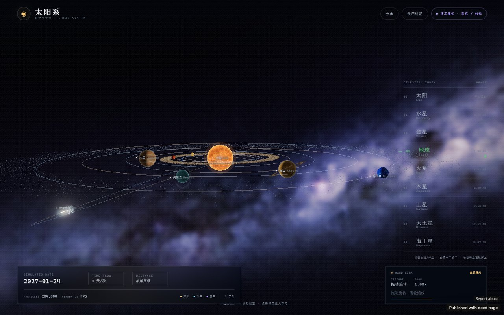
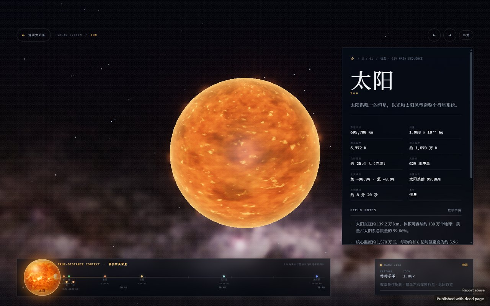
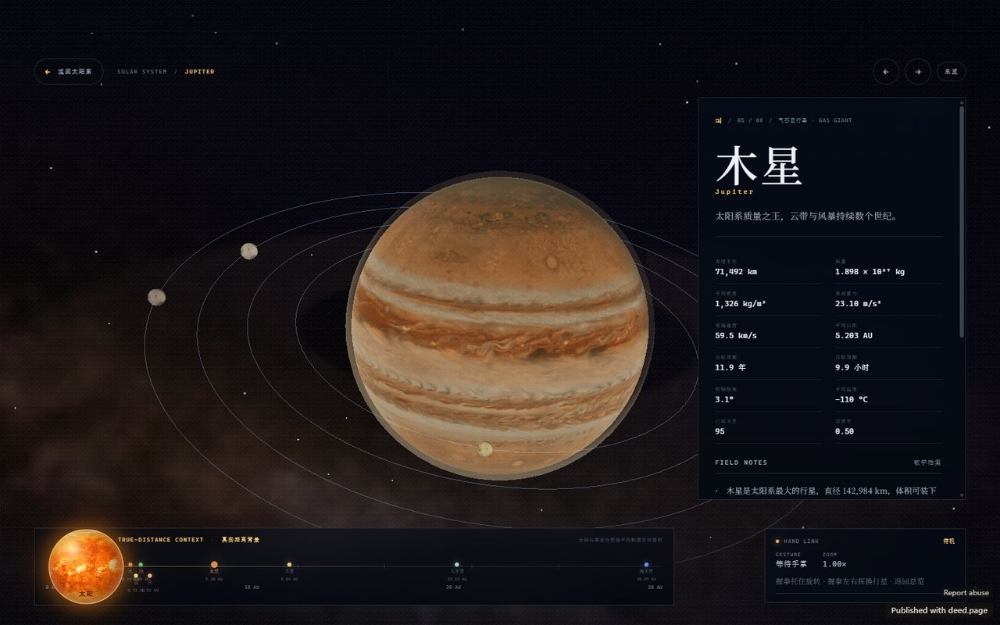
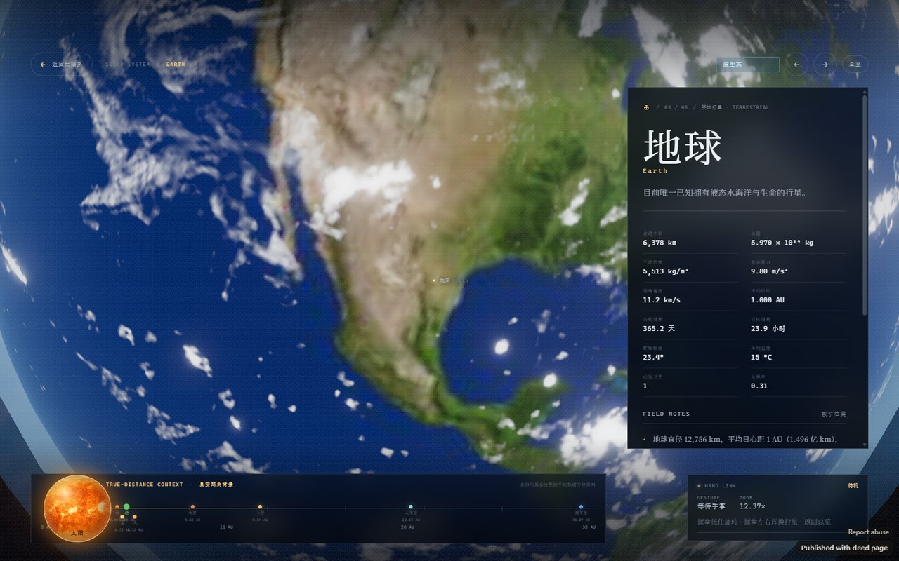
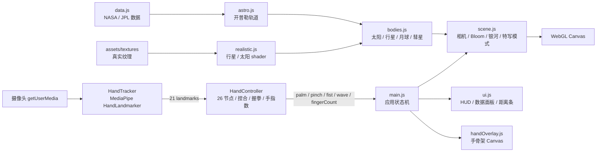

# 太阳系 · 粒子天文台

> 一个用 Three.js + MediaPipe Hands 构建的可交互太阳系教学装置：真实行星纹理、开普勒轨道、手势控制、地球磁层/辐射带、银河背景与电影感太阳。

**在线演示（长期地址）**：<https://solar-atlas-q25hm8.deed.page/solar-system/>



## 项目亮点

- **真实天文数据**：太阳、八大行星、月球与哈雷彗星；采用 NASA Planetary Fact Sheet / Sun Fact Sheet 与 JPL Standish J2000 轨道根数。
- **开普勒轨道**：椭圆轨道、倾角、升交点、近日点、周期与时间模拟，不是简单的匀速圆圈。
- **真实纹理行星**：2K/4K 行星纹理、地球昼夜/云层/大气、土星环纹理；银河背景使用处理过的银河带贴图。
- **可交互特写**：太阳、八大行星、月球、哈雷彗星都能聚焦；木星带四颗伽利略卫星；地球可切换原生态 / 完整磁层 / 范艾伦辐射带。
- **手势 + 鼠标/触控**：手掌远近缩放、捏合点击、握拳托住旋转、握拳左右横挥切换天体；也支持鼠标、滚轮、键盘与 URL 深链。
- **教学 UI**：真实距离条、天数时间流、每颗天体 10+ 项数据、help / tutorial / toast / 无障碍焦点管理。
- **纯静态、无构建**：原生 ES Modules，Three.js 与 MediaPipe 运行时全部随仓库提供，不需要 npm 构建。

## 截图

| 太阳特写 | 木星特写 |
| --- | --- |
|  |  |

| 地球特写 | 总览银河 |
| --- | --- |
|  |  |

## 快速开始

要求：Node.js 18+ 或 Python 3.10+，以及支持 WebGL2 的现代浏览器。

```bash
# 方式一：仓库自带静态服务器
npm start
# 打开 http://localhost:8000/solar-system/

# 方式二：Python
python -m http.server 8000
# 打开 http://localhost:8000/solar-system/
```

> **摄像头需要安全上下文**：请使用 `localhost` / `127.0.0.1`，或 HTTPS 域名。
> 如果只想看演示，可打开 `?demo=1`，例如 `http://localhost:8000/solar-system/?demo=1`。

### URL 参数

| 参数 | 作用 |
| --- | --- |
| `?demo=1` | 直接进入指针演示模式，不请求摄像头 |
| `?nocamera=1` | 同演示模式，永远不请求摄像头 |
| `?planet=jupiter` | 深链聚焦某颗行星（`sun` / `mercury` … `neptune` / `moon` / `halley`） |
| `?scale=true` | 使用真实距离模式（默认教学压缩） |
| `?quality=low` | 降低 DPR / Bloom / 粒子预算 |
| `?particles=120000` | 覆盖总粒子数（5000–400000） |
| `?hud=0` | 隐藏手部识别叠加层 |
| `?reducedmotion=1` | 减少动态效果 |

## 操作方式

| 操作 | 效果 |
| --- | --- |
| 手掌靠近 / 远离摄像头 | 视角拉近 / 拉远；手停住约 220ms 后锁定，不再漂移 |
| 手掌左右上下移动 | 旋转视角（方向与手同向） |
| 捏一下（拇指 + 食指） | 相当于鼠标点击：选行星、点“返回太阳系”、地球层按钮、月球等 |
| 握拳 + 移动 | 托住天体旋转查看 |
| 握拳快速左右横挥 | 切换天体，顺序：太阳 → 水星 → … → 海王星 → 太阳；向右=上一颗，向左=下一颗 |
| 地球特写中 1 / 2 / 3 指 | 原生态地球 / 完整磁层 / 范艾伦辐射带 |
| 地球特写中捏合空白处或层按钮 | 循环地球三种模型 |
| 鼠标拖动 / 滚轮 / 双指 | 旋转视角 / 缩放 |
| 键盘 `1`–`8`、`0`、`←` `→`、`Space`、`S`、`O`、`L`、`Esc` | 行星、太阳、切换、暂停、比例、轨道、地球层、退出 |
| `H` | 聚焦哈雷彗星 |

> 手势阈值在 `solar-system/src/config.js` 的 `hand` 段集中配置；不同手型/摄像头可在那里微调。

## 技术架构



### 模块职责

| 模块 | 职责 |
| --- | --- |
| `solar-system/src/main.js` | 应用状态机、手势判定、相机交互、URL/键盘/分享、调试桥 |
| `solar-system/src/data.js` | 太阳/八大行星/环/卫星/彗星的数据与教学 facts |
| `solar-system/src/astro.js` | J2000 轨道根数、开普勒方程、椭圆轨道点、时间格式化 |
| `solar-system/src/bodies.js` | 构建太阳、行星、月球、卫星、彗星、轨道线、拾取与距离/比例映射 |
| `solar-system/src/realistic.js` | 真实纹理球体、太阳/地球/环 shader、大气与云层 |
| `solar-system/src/earthLayers.js` | 地球磁层、范艾伦辐射带、极光帷幕 |
| `solar-system/src/scene.js` | WebGLRenderer、EffectComposer、Bloom、相机、银河、特写/总览模式 |
| `solar-system/src/galaxy.js` | 银河天幕贴图与颜色处理 |
| `solar-system/src/comet.js` | 哈雷彗星核/彗发/彗尾 |
| `solar-system/src/particles.js` | 小行星带、柯伊伯带、星场、粒子 Geometry/Shader |
| `solar-system/src/handControls.js` | 21 基础点 + 5 衍生点、捏合/握拳/手指数状态机 |
| `solar-system/src/handOverlay.js` | 摄像头 cover 映射、手骨架绘制 |
| `solar-system/src/ui.js` | 所有 DOM 更新，不直接操作 Three.js |
| `src/handTracker.js` | MediaPipe 初始化、摄像头、30fps 检测、错误映射 |
| `src/tension.js` | 手部张合度数学（独立纯函数，可复用） |

更详细的坐标、轨道、手势与渲染流程见 [docs/ARCHITECTURE.md](docs/ARCHITECTURE.md)。

## 天文与比例说明

- 行星位置使用 **JPL/Standish J2000 平均轨道根数**，通过开普勒方程解偏近点角后计算日心坐标；轨道倾角、升交点、近日点都参与。
- 默认 **教学压缩距离**：保留轨道顺序、偏心率与相对远近关系，但把外行星拉近以适合一屏观看。
- `?scale=true` 为**真实距离**模式：距离按 AU 线性映射，大小仍做视觉夸张，UI 会明确标注。
- 行星半径、土星环、木星卫星均为**教学可视化尺度**，不是严格等比例；数据面板展示真实数值。
- 时间：总览默认 **5 天/秒**；聚焦天体时切换为“自转时间”，默认 **20 秒/天**（地球）。可在 HUD 中切换时间流。

## 项目结构

```text
.
├── index.html                  # 根重定向 → solar-system/
├── solar-system/
│   ├── index.html              # 应用入口
│   ├── styles.css
│   ├── favicon.svg
│   ├── src/                    # 应用模块（见上表）
│   └── assets/textures/        # 行星/银河纹理
├── src/
│   ├── handTracker.js          # MediaPipe 封装（共享）
│   ├── tension.js              # 张合度纯函数（共享）
│   └── config.js               # 摄像头/跟踪/张力阈值（共享）
├── vendor/
│   ├── three/                  # Three.js r187 + postprocessing addons
│   └── mediapipe/              # tasks-vision + wasm + hand_landmarker.task
├── tools/serve.mjs             # 零依赖静态服务器
├── docs/ARCHITECTURE.md
├── screenshots/
├── LICENSE
├── THIRD_PARTY.md
└── package.json
```

## 部署

### 静态托管

这是纯静态站点，把仓库根目录作为站点根部署即可：

- 本仓库根 `index.html` 会重定向到 `solar-system/`；
- 应用实际路径是 `/solar-system/index.html`；
- 需要为 `.wasm` 返回 `application/wasm`（`tools/serve.mjs` 已处理）。

### GitHub Pages

1. 仓库 **Settings → Pages**；
2. Source 选择 **Deploy from a branch**，分支 `main`，目录 `/ (root)`；
3. 打开 `https://<用户名>.github.io/solar-system/`，根页面会跳转到应用。

> GitHub Pages 项目站点路径为 `/<repo>/`，所以应用最终地址是
> `https://<用户名>.github.io/solar-system/solar-system/`。

### 摄像头与 HTTPS

`getUserMedia` 只在 `localhost` 或 HTTPS 下可用。部署到 GitHub Pages 后使用 `https://` 域名即可；本地开发建议 `http://localhost:8000`。

## 已知限制

- MediaPipe 模型与 wasm 首次加载需要一定时间（视网络而定），加载完成后浏览器会缓存。
- 手势识别受摄像头、手型、光照影响；阈值可在配置中调整。
- 真实距离模式下行星会非常小，这是真实比例的直观结果。
- 太阳、行星、卫星、环的大小为教学可视化尺度，不是严格物理比例。
- 磁层/极光/彗尾为科学可视化近似，不是数值模拟。

## 数据与素材来源

- NASA Planetary Fact Sheet：<https://nssdc.gsfc.nasa.gov/planetary/factsheet/>
- NASA Sun Fact Sheet：<https://nssdc.gsfc.nasa.gov/planetary/factsheet/sunfact.html>
- JPL/Standish J2000 轨道根数：<https://ssd.jpl.nasa.gov/txt/p_elem_t1.txt>
- 行星纹理：Solar System Scope Textures，CC BY 4.0（<https://www.solarsystemscope.com/textures/>）
- Three.js：MIT
- MediaPipe Tasks Vision：Apache-2.0

详见 [THIRD_PARTY.md](THIRD_PARTY.md)。

## 许可

代码以 **MIT License** 开源，见 [LICENSE](LICENSE)。
纹理与第三方库遵循各自的许可；转载/再发布时请保留 `THIRD_PARTY.md` 中的署名与许可说明。

---

如果这个项目对你有帮助，欢迎 Star；也欢迎提 Issue/PR 一起把手势阈值、行星细节和教学数据做得更好。
