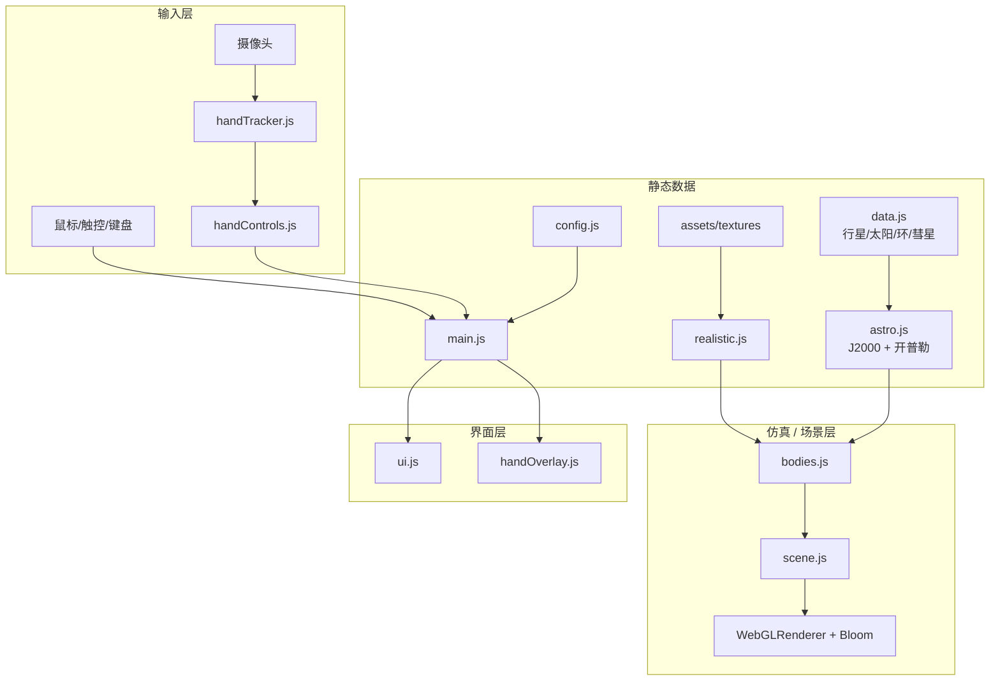

# Architecture & Technical Flow

这份文档解释“数据从哪里来、每一帧发生了什么、手势怎样变成交互”，方便二次开发。

## 1. 数据流总览



## 2. 启动顺序

1. `index.html` 设置 import map（`three`、`three/addons/`）并加载 `src/main.js`。
2. `main.js` 调用 `resolveRuntime()` 读取 URL 参数，得到粒子预算、DPR、是否演示等。
3. `createSceneStage()` 创建：
   - `WebGLRenderer` 与透视相机；
   - `EffectComposer` → `RenderPass` → `UnrealBloomPass` → `OutputPass`；
   - `createSolarBodies()`：太阳、行星、月球、木星卫星、彗星、轨道、小行星带/柯伊伯带/星场；
   - `createGalaxyBackdrop()`：银河天幕。
4. `createUI()` 绑定按钮、帮助、教程、错误面板与 HUD。
5. `boot()` 决定初始阶段：`intro` / `overview`（`?demo=1`）/ `focus`（`?planet=...`）。
6. 首帧渲染后设置 `window.__SOLAR_SYSTEM__.ready = true`。

### 应用状态机

```text
intro ──开始/演示──> loading ──成功──> overview ──选中──> focus
  ^                    │                  ^                │
  │                    └──失败──> error   └──返回──────────┘
  └──────────── 关闭错误 / 返回太阳系 ───────┘
```

- `focus` 下可以再切换天体，不必回总览。
- 空间天气/4 指全景在后续版本已移除，不属于当前交互。
- 手机端/桌面端共用同一状态机，只改变 UI 布局与相机取景。

## 3. 天文学层

### 3.1 数据

`data.js` 包含：

- `SUN`、`PLANETS`（八大行星）、`MOON`、`COMET`（哈雷）以及木星卫星数据；
- 轨道根数、半径/质量/密度/重力/温度/自转/轴倾角/卫星数等教学字段；
- 环的结构（土星 C/B/A + Cassini/Encke，木星稀薄尘埃环，天王星/海王星淡环）。

### 3.2 开普勒轨道

`astro.js` 的流程：

```text
J2000 根数 (+ rates × centuries)
  → 平近点角 M
  → 牛顿迭代解 Kepler 方程 M = E − e·sinE
  → 真近点角 ν / 日心距 r
  → 轨道平面坐标
  → 应用倾角 i、升交点 Ω、近日点黄经 ϖ
  → 日心黄道坐标 (x, y, z) [AU]
```

`orbitPathAU()` 生成 257 点闭合轨道，供 `bodies.js` 画线。

### 3.3 显示比例

`bodies.js` 有两个映射：

- **距离**：`displayDistanceAU(au, mode)`，`demo` 压缩、`true` 线性；
- **半径**：`displayRadius(km)`，按幂函数压缩，保证岩石行星可见。

行星轨道方向、相对顺序、偏心率和时间节奏保留；行星大小和卫星轨道做了教学夸张，UI 会标注。

## 4. 渲染层

### 4.1 真实纹理行星

`realistic.js`：

- `PLANET_TEXTURES` 把行星 id 映射到 `assets/textures/*.jpg`；
- `SphereGeometry(radius, 72, 48)` + 自定义 shader：
  - 世界法线、太阳方向漫反射；
  - 地球夜景纹理、云层、外层淡蓝大气；
  - 气态行星条带纹理 + 轻微整体 tint；
  - 土星环使用 RGBA 环纹理 + 行星本影 + 太阳方向；
- 太阳是单独的 4K 纹理球 + 米粒/耀斑 shader + 日冕 shader，接缝被固定在背面。

### 4.2 银河天幕

`galaxy.js` 使用一张处理过的银河带贴图，贴在半径约 420 的球体内侧：

- 背景固定在世界坐标，相机旋转时银河会随之变化；
- 特写时通过 `setDim()` 压暗，不抢主体；
- 太阳特写额外叠加冷色星点（透明度呼吸），其他特写也共享这套星点。

### 4.3 地球结构层

`earthLayers.js` 提供三种模式：

| 模式 | 内容 |
| --- | --- |
| `none` | 原生态地球 + 云层 + 大气 |
| `magnetic` | 非对称偶极场线（向阳压缩、夜侧拉长）+ 弓激波/磁层顶 + 磁尾 |
| `radiation` | 内/外范艾伦辐射带粒子 + 薄环 + 极光帷幕 |

切换入口：地球特写按钮、键盘 `L`、捏合点地球 / 空白处循环、1/2/3 指手势。

### 4.4 后处理

- `UnrealBloomPass`：太阳、环、极光、UI 风格光晕；
- `OutputPass`：ACES + sRGB；
- DPR 上限 1.9（桌面）/1.5（移动）；
- Bloom 分辨率按 `bloomScale` 降采样，避免移动端过热。

## 5. 手部输入链路

### 5.1 原始 21 点

MediaPipe Hand Landmarker 输出 `NormalizedLandmark[]`（x/y/z 归一化）。`src/handTracker.js` 负责：

```text
getUserMedia(video)
  → FilesetResolver.forVisionTasks(vendor/mediapipe/wasm)
  → HandLandmarker(VIDEO, numHands=1, GPU → CPU fallback)
  → requestVideoFrameCallback 约 30fps
  → detectForVideo
  → onFrame({ landmarks, aspect, timestamp })
```

错误码：`CAMERA_UNSUPPORTED` / `PERMISSION_DENIED` / `NOT_FOUND` / `IN_USE` / `FAILED` / `MODEL_LOAD_FAILED`。

### 5.2 衍生节点

`handControls.js` 在 21 点基础上派生 **5 个节点**：

- `palmCenter`：掌心中心；
- `pinchMid`：拇指尖 + 食指尖中点；
- `indexTip`：食指指尖（捏合点击的指针）；
- `thumbTip`：拇指尖；
- `palmSpan`：掌心尺度（用于判断手掌远近）。

总计 26 个节点；旧版的 `palmAxis`（法线）已删除。

### 5.3 手势状态

- **张合度 / openness**：复用 `src/tension.js`；
- **捏合**：拇指-食指距离 / palmSpan，阈值 `startRatio=0.46`、`releaseRatio=0.68`，带滞回；
- **握拳**：0 指伸展 + openness 低；
- **手指数**：四指（食指/中指/无名指/小指）的伸展判定；
- **握拳横挥**：在 `main.js` 中基于 palm x 的 460ms 窗口、跨度与速度阈值触发切换；
- **缩放**：手掌远近（palmSpan 变化）驱动，手停住 220ms 后锁定；
- **视角**：掌心位置映射到 yaw/pitch，方向与手同向。

### 5.4 捏合 = 指针点击

```text
pinchStarted
  → pinch midpoint / indexTip
  → computeCoverLayout()（和摄像头背景相同的 cover/镜像映射）
  → 屏幕坐标 (x, y)
  → elementFromPoint 命中按钮/链接？
      是 → click()
      否 → stage.pick() 3D 拾取
      3D 未命中 → nearestBodyAt() 最近天体回退
```

因此捏合可以点击“返回太阳系”、地球层按钮、行星按钮，也可以选中 3D 天体。

## 6. 时间系统

- 总览：`simMs += dt × daysPerSecond × 86400 × 1000`，默认 **5 天/秒**；
- 聚焦天体：切换为 **自转视角**，`daysPerSecond = 1 / 20`，即地球约 **20 秒/天**；
- 行星自转按 `rotationHours` 相对地球缩放；负值表示逆行；
- 月球公转、木星卫星公转使用教学压缩周期；
- 真实自转周期仍显示在数据面板。

## 7. 焦点相机

`scene.js` 的 `setFocus(id)` 会：

1. `bodies.setFocus(id)` 隐藏其他天体（月球/地球特写保留地球—月球）；
2. 计算 `fitFocusDistance()` 与相机目标；
3. 选择朝向太阳的 yaw，使行星昼面可见；
4. `alignGalaxyToView()` 把银河带对齐到当前相机方向，之后保持 world-fixed。

## 8. 目录与扩展点

| 想改什么 | 改哪里 |
| --- | --- |
| 行星数据 / facts | `solar-system/src/data.js` |
| 轨道公式 / 时间格式 | `solar-system/src/astro.js` |
| 行星纹理 / 环 / 太阳 | `solar-system/src/realistic.js` |
| 地球磁层/辐射带/极光 | `solar-system/src/earthLayers.js` |
| 银河 | `solar-system/src/galaxy.js` |
| 手势阈值 | `solar-system/src/config.js` 的 `hand` 段 |
| 手部状态机 | `solar-system/src/handControls.js` |
| UI 文案 / 数据面板 | `solar-system/src/ui.js`、`solar-system/index.html` |
| 相机/后处理 | `solar-system/src/scene.js` |

## 9. 性能建议

- 默认桌面 204,000 粒子；移动 112,000；
- `?quality=low` 会降低 DPR/Bloom/粒子；
- 粒子球/环/带全部使用 `THREE.Points` + 自定义 shader，避免逐粒子 Mesh；
- 模型只创建一次，切换特写只改可见性与相机；
- 移动端限制 DPR，Bloom 降采样。

## 10. 已知近似

- 磁层、辐射带、极光、彗尾为科学可视化近似；
- 行星大小/卫星轨道/环宽度不是严格比例；
- 默认距离为教学压缩，`?scale=true` 才是线性 AU；
- 光照是艺术化方向光，不是物理光线追踪。
